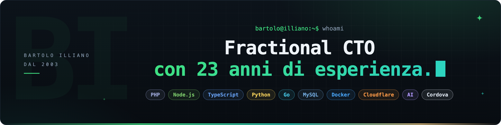

 

---

## Chi sono

Sono un **Fractional CTO** e **Senior Full Stack Developer** con **23 anni di esperienza**: scrivo software dal 2003, da quando i siti si caricavano via FTP, e oggi progetto sistemi che girano su infrastrutture cloud distribuite. Affianco founder e team nelle decisioni di architettura, team e prodotto: la guida di un CTO senior sul monte ore che serve davvero, senza il costo di una figura full-time.

Sul fronte tecnico mi specializzo in **sistemi SaaS multi-tenant**, flussi **CRM e marketing automation**, **pipeline AI e agenti** integrati in prodotti già in produzione ed **efficientamento dei processi**, perché spesso il collo di bottiglia non è il codice, ma il modo in cui il lavoro attraversa l'azienda.

---

## Cosa faccio

🧭 **Fractional CTO** — Architettura, scelte tecnologiche e roadmap, con il debito tecnico sotto controllo mentre l'azienda cresce.

🏗️ **Sistemi SaaS** — Piattaforme web e mobile multi-tenant, dall'MVP al prodotto che regge carico e scadenze.

🤖 **AI & agenti** — Pipeline AI e agenti integrati nei prodotti e nei processi aziendali, testati e supervisionati.

⚙️ **CRM & automazione** — Flussi CRM, marketing automation e integrazioni che tolgono lavoro manuale ai team.

👥 **Team & delivery** — Assunzioni tech, code review, standard condivisi, CI/CD e osservabilità.

🔍 **Due diligence tecnica** — Audit di codebase, sicurezza e architettura per founder e investitori.

---

## Progetti open source

📨 **[AgentRoom](https://github.com/dedrisproject/AgentRoom)** — Inbox condivisa per gli agenti AI di coding: si coordinano, segnalano i blocchi e chiudono i thread risolti. `Go`

📱 **[DedrisFramework](https://github.com/DedrisLab/DedrisFramework)** — UI framework e starter kit per app iOS e Android con Apache Cordova, senza build step. `HTML/CSS/JS`

🎨 **[DedrisGenAI](https://github.com/dedrisproject/DedrisGenAI)** — Generatore di immagini AI offline con web UI: niente account, niente cloud. `Python`

🔔 **[cordova-plugin-push-notification-v2026](https://github.com/dedrisproject/cordova-plugin-push-notification-v2026)** — Notifiche push zero-config per Cordova: FCM su Android, APNs nativo su iOS. `JavaScript`

---

## Stack tecnologico

 

---

*Hai una startup da far crescere o un prodotto da tirar su? Raccontami dove sei su [bartoloilliano.it](https://bartoloilliano.it/contatti/).*

